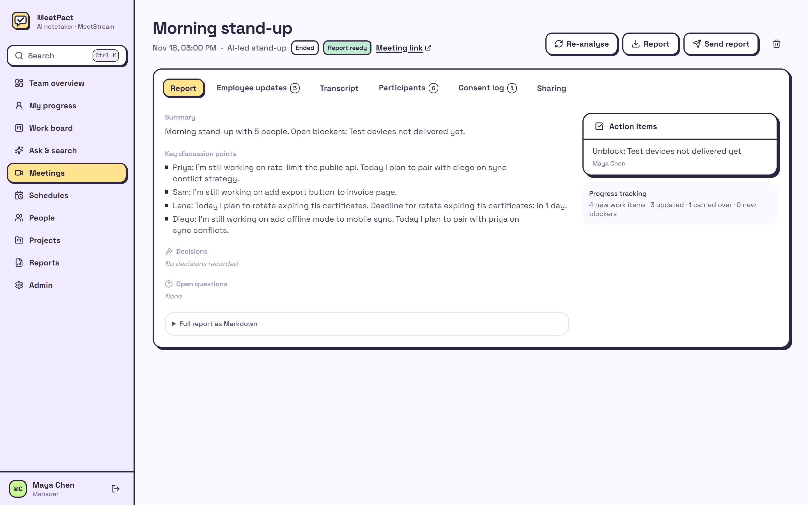

<div align="center">


# MeetPact

**An AI notetaker that keeps track of what everyone promised.** A bot joins your meeting, writes the
notes, and carries each person's commitments, progress and blockers forward from one meeting to the
next. It can also run your stand-up for you, out loud, from the first hello to "I'll leave the meeting now".

[](https://github.com/ThalhaAhamed/meetpact/actions)


[](https://meetstream.ai)
[](LICENSE)

[Quick start](#-quick-start) · [Features](#-features) · [Screenshots](#-screenshots) · [How it works](#-how-it-works) · [Docs](#-documentation) · [FAQ](#-faq)

</div>

<p align="center"></p>

MeetPact sends a [MeetStream](https://meetstream.ai) bot into Google Meet, Zoom or Microsoft Teams.
After the call it fetches the transcript, has Claude or Gemini pull out the summary, decisions and
action items, and, unlike a plain notetaker, updates a **running record per person**: what they
finished, what's in progress, what they committed to and by when, and what's blocking them. Work that
isn't reported as done is carried into the next meeting, so a manager sees what keeps slipping and
the AI stand-up host can ask "last time you said X was nearly done, did it land?"

It is self-hosted: clone it, add a MeetStream key and a Claude or Gemini key, and run it.

## 🚀 Quick start

```bash
git clone https://github.com/ThalhaAhamed/meetpact.git
cd meetpact
cp .env.example .env        # add MEETSTREAM_API_KEY and ANTHROPIC_API_KEY or GEMINI_API_KEY
docker compose up --build   # → http://localhost:8000
```

The first account you create becomes the admin. Without Docker (Python 3.12+, Node 22+):

```bash
cd backend && python -m venv .venv && .venv/bin/pip install -r requirements.txt
.venv/bin/python -m uvicorn app.main:app --port 8000          # terminal 1 (Windows: .venv\Scripts\...)
cd frontend && npm install && npm run dev                      # terminal 2 → http://localhost:5173
```

| Key | Needed for | Get one |
|---|---|---|
| `MEETSTREAM_API_KEY` | Sending bots and the AI stand-up host | [app.meetstream.ai](https://app.meetstream.ai/api-key) |
| `ANTHROPIC_API_KEY` **or** `GEMINI_API_KEY` | Analysing transcripts, Ask | [console.anthropic.com](https://console.anthropic.com) · [aistudio.google.com](https://aistudio.google.com/apikey) |
| `cloudflared` *(optional, recommended)* | A public address for live webhooks, so the stand-up host sees who's in the call and leaves right after its goodbye | Install [cloudflared](https://developers.cloudflare.com/cloudflare-one/connections/connect-networks/downloads/); MeetPact starts the tunnel itself |

No public address is required: without one MeetPact polls MeetStream, so it works from a laptop.
Everything is in [docs/configuration.md](docs/configuration.md).

## ✨ Features

- 🎙️ **AI notetaker** - joins on demand, on a schedule, or from your calendar. Posts one short recording note once admitted, and can be paused or removed from the meeting page.
- 🧑‍✈️ **AI stand-up host** - opens the meeting, goes round each person by name, follows up on what they committed to last time, opens the floor ("anything else?"), recaps, and leaves. Powered by MeetStream's voice agents (Gemini Live by default).
- 📈 **Progress across meetings** - every update moves long-lived work items (planned → in progress → blocked → done). Unfinished work is carried forward; blockers stay open until someone says they're resolved; every change has a history with the meeting it came from.
- 🚨 **Needs your attention** - the manager dashboard leads with overdue work, open blockers and work that keeps slipping.
- 🗂️ **Work board** - every commitment as a drag-and-drop board, by person or project.
- 🔎 **Ask & search** - "What is blocking the team?", "What did Priya commit to?" Answers cite the meeting and date and only use records you're allowed to see. <kbd>Ctrl</kbd>+<kbd>K</kbd> jumps anywhere.
- ✅ **People correct the AI** - everyone can confirm or correct what was recorded about them.
- 🔐 **Sharing and privacy** - per meeting, choose who sees the full report and who sees individual updates. Roles for admins, managers, team leads and employees. Automatic deletion of transcripts and recordings, and "erase all data" per person.
- 📤 **Delivery and integrations** - reports by email and Slack; optional ClickUp, Jira, Asana, Trello and monday.com tasks with status sync; Google Calendar and Outlook auto-join.

## 📸 Screenshots

| | |
|---|---|
|  |  |
| **Meeting report** - summary, decisions, action items, each person's update | **Work board** - drag a card to change its status |
|  |  |
| **Ask** - answers with sources, limited to what you may see | **Person** - open work, history, review of AI records |

<p align="center"></p>

## 🧠 How it works

```
 Schedules / calendar / "Send bot" ──► create_bot (join_at) ──────────────► MeetStream bot in the call
                                        + MIA voice agent for stand-ups        │
 watcher (polls) or webhooks ◄── status, roster, chat ◄────────────────────────┘
   • admitted → one recording note in the chat
 call ends → transcript → speakers matched to people
           → Claude / Gemini (typed JSON) → updates, work items, blockers, history
           → report → email / Slack → dashboards, board, Ask
```

The analysis is given the transcript **and** each attendee's open work and blockers, so it can say
"item 123 is now done" instead of inventing a new task; the tracker then applies that
deterministically (de-duplication, carry-over, history). Details: [docs/architecture.md](docs/architecture.md).

## 📚 Documentation

| | |
|---|---|
| [Self-hosting](docs/self-hosting.md) | Run it on your own server with a domain and HTTPS |
| [Configuration](docs/configuration.md) | Every environment variable |
| [Architecture](docs/architecture.md) | Pipeline, data model, MeetStream APIs used |
| [AI stand-up host](docs/standup.md) | How the voice agent runs a meeting, providers, limits |
| [Privacy](docs/privacy.md) | The recording note, access, retention |
| [Integrations](docs/integrations.md) | Calendar, email, Slack, task tools |
| [Development](docs/development.md) | Running from source, demo data, tests, migrations |
| [Troubleshooting](docs/troubleshooting.md) | Common problems and fixes |

## ❓ FAQ

**Where does it run?** On your own machine or server; there is no hosted version. On a server, set
`APP_URL` to your domain ([self-hosting guide](docs/self-hosting.md)).

**Does it need a public URL?** No. Without one it polls MeetStream. If `cloudflared` is installed,
MeetPact opens a tunnel by itself (only MeetStream's paths go through it), which adds live webhooks:
the stand-up host sees who is in the call and leaves right after its
goodbye. Without it the host leaves shortly after everyone else has left.

**Which AI does it use?** Claude or Gemini for analysis and Ask (`ANALYSIS_PROVIDER`). The stand-up
voice is a MeetStream MIA agent, Gemini Live by default.

**Can the bot see who's in the call?** Only with a public address (the automatic tunnel counts):
MeetStream then sends live join/leave events. Without one, the participant list is only available after
the meeting, so the stand-up host works from the meeting's team and skips people who don't answer.

**Is the AI always right?** No. Everyone can confirm or correct what was recorded about them, and every
change is kept in history.

## 🤝 Contributing

Issues and pull requests are welcome - see [CONTRIBUTING.md](CONTRIBUTING.md). Report security problems
privately as described in [SECURITY.md](SECURITY.md).

## 📄 License

[MIT](LICENSE). MeetPact is an independent project built on the [MeetStream](https://meetstream.ai) API.
