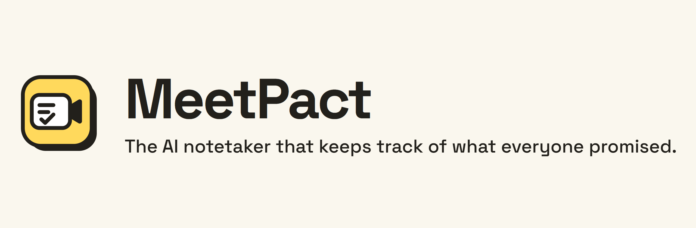
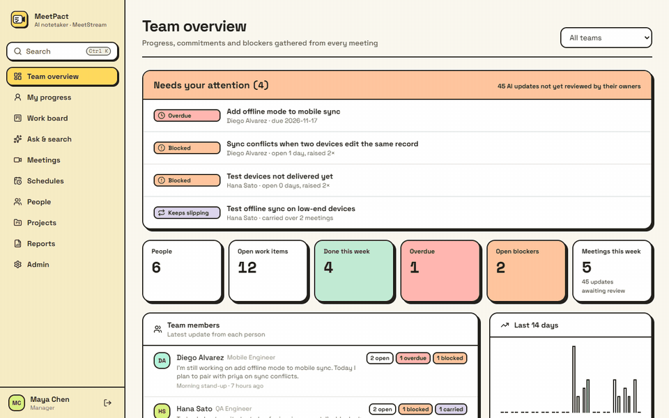
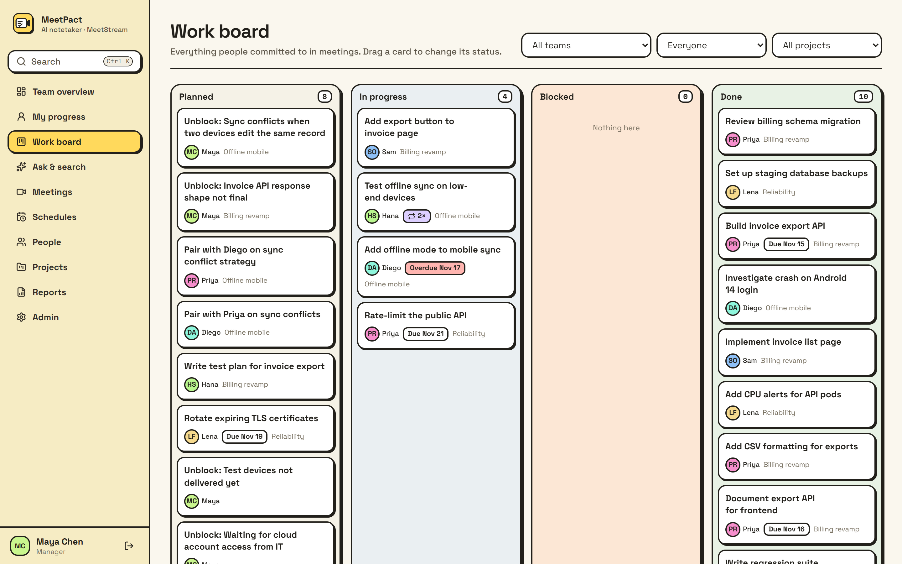
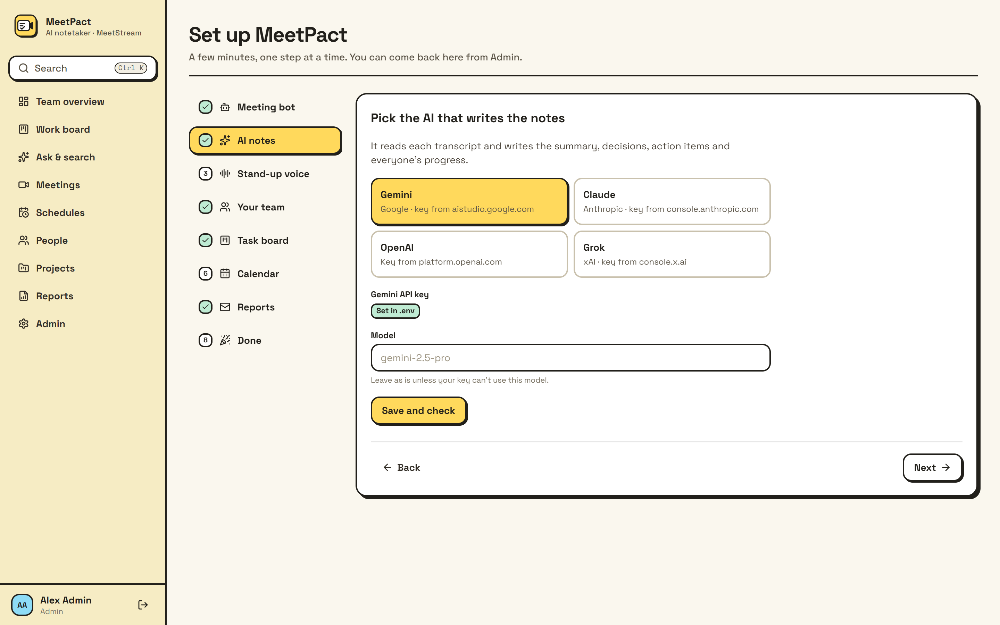
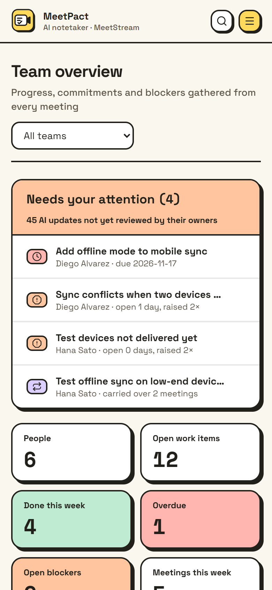

<div align="center" style="border-bottom: none">
    <h1>
        
        <br>
        Self-Hosted AI Meeting Notetaker &amp; Stand-up Host
    </h1>
    <a href="https://github.com/ThalhaAhamed/meetpact/actions"></a>
    <a href="LICENSE"></a>
    <a href="https://meetstream.ai"></a>
    <a href="docs/self-hosting.md"></a>
    
    
    
    <br>
    <h3>
    <br>
    Open Source • Self-Hosted • Tracks Progress Across Meetings
    </h3>
    <p align="center">
    <a href="#installation"><b>Install</b></a> •
    <a href="#key-features-in-action"><b>Features</b></a> •
    <a href="docs/self-hosting.md"><b>Self-hosting</b></a> •
    <a href="#documentation"><b>Docs</b></a> •
    <a href="https://meetstream.ai"><b>MeetStream</b></a>
    </p>
    <p align="center">

A bot joins your Google Meet, Zoom or Teams call, writes the notes, and keeps a **running record per person**: what they finished, what they're working on, what they promised and by when, and what's blocking them. Unfinished work carries into the next meeting, so you see what keeps slipping. It can also **run your stand-up out loud**, from "tell me what you worked on" to "I'll leave the meeting now".

</p>

<p align="center">
    
    <br>
    <sub>Team overview → meeting report → each person's update → work board → Ask</sub>
</p>

</div>

---

<details>
<summary>Table of Contents</summary>

- [Introduction](#introduction)
- [Why MeetPact?](#why-meetpact)
- [Features](#features)
- [Installation](#installation)
- [Key Features in Action](#key-features-in-action)
- [How It Works](#how-it-works)
- [Documentation](#documentation)
- [FAQ](#faq)
- [Contributing](#contributing)
- [License](#license)

</details>

## Introduction

MeetPact sends a [MeetStream](https://meetstream.ai) bot into your meetings. After the call it fetches the transcript and has the AI of your choice (Gemini, Claude, OpenAI or Grok) pull out the summary, decisions and action items. Unlike a plain notetaker, it then updates each person's work: tasks move from planned to in progress to done, blockers stay open until someone says they're resolved, and deadlines are tracked. Every change links back to the meeting it came from.

It runs on your own machine or server. There is no hosted version and no data leaves your install except to MeetStream and the AI provider you pick.

## Why MeetPact?

Most notetakers give you a summary per meeting. Teams need the thread **between** meetings:

- **Commitments don't get lost:** "I'll ship the export by Friday" becomes a task with a deadline, owned by that person.
- **Slipping work is visible:** anything reported as unfinished meeting after meeting is flagged, before it becomes a surprise.
- **Stand-ups run themselves:** the AI host asks each person for their update by name, follows up on what they promised last time, and raises overdue or unassigned work.
- **Your board stays current:** use MeetPact's board or your team's Trello board; meetings create the cards and move them.
- **People stay in control:** everyone can confirm or correct what was recorded about them.

## Features

- **AI notetaker:** joins on demand, on a schedule, or from Google Calendar. Posts one short recording note when admitted; pause or remove it from the meeting page.
- **AI stand-up host:** speaks in the meeting with a voice you choose (Gemini Live, OpenAI, Grok or Claude), goes round the team by name and leaves when it's done.
- **Progress across meetings:** long-lived work items, carry-over, blockers, deadlines and a full history.
- **Manager dashboard:** leads with what needs attention: overdue work, open blockers, work that keeps slipping.
- **Work board or Trello:** each team picks MeetPact's drag-and-drop board or its own Trello board, shown inside MeetPact with who is on each card.
- **Ask & search:** "What is blocking the team?" Answers cite the meeting and only use what you're allowed to see.
- **Sharing and roles:** per-meeting sharing; admins, managers, team leads and employees; automatic deletion of recordings.
- **Delivery:** reports by email and Slack; tasks to ClickUp, Jira, Asana or monday.com.
- **Setup guide:** a first-run guide with live checks for every key; nothing to edit by hand.

## Installation

```bash
git clone https://github.com/ThalhaAhamed/meetpact.git
cd meetpact
docker compose up --build   # → http://localhost:8000
```

Open the app, create the admin account, and the **setup guide** walks you through the rest: the MeetStream key, the AI for notes, the stand-up voice, your team, its task board, calendar and reports. Keys can also go in `.env` (`cp .env.example .env`); `.env` always wins.

<details>
<summary><b>Run without Docker, or on a server</b></summary>

Python 3.12+ and Node 22+:

```bash
cd backend && python -m venv .venv && .venv/bin/pip install -r requirements.txt
.venv/bin/python -m uvicorn app.main:app --port 8000          # terminal 1 (Windows: .venv\Scripts\...)
cd frontend && npm install && npm run dev                      # terminal 2 → http://localhost:5173
```

On a server, set `APP_URL` to your domain and put HTTPS in front: see the [self-hosting guide](docs/self-hosting.md). On a laptop, install [cloudflared](https://developers.cloudflare.com/cloudflare-one/connections/connect-networks/downloads/) and MeetPact opens a tunnel by itself, so the stand-up host can see who's in the call and leave right after its goodbye.

| You need | For | Get one |
|---|---|---|
| MeetStream API key | Sending bots and the stand-up host | [app.meetstream.ai](https://app.meetstream.ai) |
| One AI key: Gemini, Claude, OpenAI or Grok | Notes, summaries and Ask | [Gemini](https://aistudio.google.com/apikey) · [Claude](https://console.anthropic.com) · [OpenAI](https://platform.openai.com) · [Grok](https://console.x.ai) |

</details>

## Key Features in Action

### 🚨 Team overview

What needs your attention comes first: overdue work, open blockers and anything that keeps slipping, then each person's latest update and the week's numbers.

<p align="center">
    
</p>

### 📝 Meeting reports

Summary, key points, decisions, open questions and action items with owners and deadlines. Each person gets their own update, which they can confirm or correct.

<p align="center">
    
</p>

### 🗂️ Work board, or your Trello board

Every commitment as a card: planned, in progress, blocked, done. Drag to change status. Teams on Trello see their live Trello board here, with who is on each card; meetings add cards and move them.

<p align="center">
    
</p>

### 🧑‍✈️ AI stand-up host

Pick the voice: Gemini Live, OpenAI, Grok or Claude. The host opens with *"Tell me what you worked on, any updates and your status"*, goes round each person, follows up on what they committed to last time, raises overdue or unassigned work, recaps and leaves. **Check with MeetStream** confirms your account can use the voice before the meeting.

<p align="center">
    
</p>

### 🔎 Ask & search

Ask in plain words. Answers cite the meeting and date, and only use records you're allowed to see. <kbd>Ctrl</kbd>+<kbd>K</kbd> jumps anywhere.

<p align="center">
    
</p>

### 👤 Each person's progress

Open work, what keeps slipping, blockers, and the history of every change with the meeting it came from.

<p align="center">
    
</p>

### 🧭 Setup guide

A first-run guide with a live check at every step: meeting bot, AI for notes (Gemini, Claude, OpenAI or Grok), stand-up voice, team, task board, calendar and reports.

<p align="center">
    
</p>

### 📱 On your phone

<p align="center">
    
</p>

## How It Works

```
 Schedules / calendar / "Send bot" ──► create_bot (join_at) ──────────────► MeetStream bot in the call
                                        + MIA voice agent for stand-ups        │
 watcher (polls) or webhooks ◄── status, roster ◄──────────────────────────────┘
   • admitted → one recording note in the chat
 call ends → transcript → speakers matched to people
           → Gemini / Claude / OpenAI / Grok (typed JSON) → updates, work items, blockers, history
           → report → email / Slack → dashboards, board (or Trello), Ask
```

The AI gets the transcript **and** each attendee's open work and blockers, so it can say "item 123 is now done" instead of inventing a new task; the tracker applies that deterministically (de-duplication, carry-over, history). Details: [docs/architecture.md](docs/architecture.md).

## Documentation

| | |
|---|---|
| [Self-hosting](docs/self-hosting.md) | Your own server with a domain and HTTPS |
| [Configuration](docs/configuration.md) | Every setting |
| [AI stand-up host](docs/standup.md) | How the host runs a meeting, voices, limits |
| [Integrations](docs/integrations.md) | Trello boards, calendar, email, Slack, task tools |
| [Architecture](docs/architecture.md) | Pipeline, data model, MeetStream APIs used |
| [Privacy](docs/privacy.md) | The recording note, access, retention |
| [Development](docs/development.md) | Running from source, demo data, tests, migrations |
| [Troubleshooting](docs/troubleshooting.md) | Common problems and fixes |

## FAQ

**Where does it run?** On your own machine or server; there is no hosted version. On a server, set `APP_URL` to your domain.

**Which AI does it use?** Your choice of Gemini, Claude, OpenAI or Grok for the notes. The stand-up host's voice runs on MeetStream: Gemini Live by default, or OpenAI, Grok or Claude.

**Can the bot see who's in the call?** It gets live join and leave events when MeetPact has a public address (a server, or the automatic tunnel). MeetStream doesn't report people who were already there when the bot joined, so the host also asks "anyone else with an update?"

**Is the AI always right?** No. Everyone can confirm or correct what was recorded about them, and every change is kept in history.

## Contributing

Issues and pull requests are welcome: see [CONTRIBUTING.md](CONTRIBUTING.md). Report security problems privately as described in [SECURITY.md](SECURITY.md).

## License

[MIT](LICENSE). MeetPact is an independent project built on the [MeetStream](https://meetstream.ai) API.
