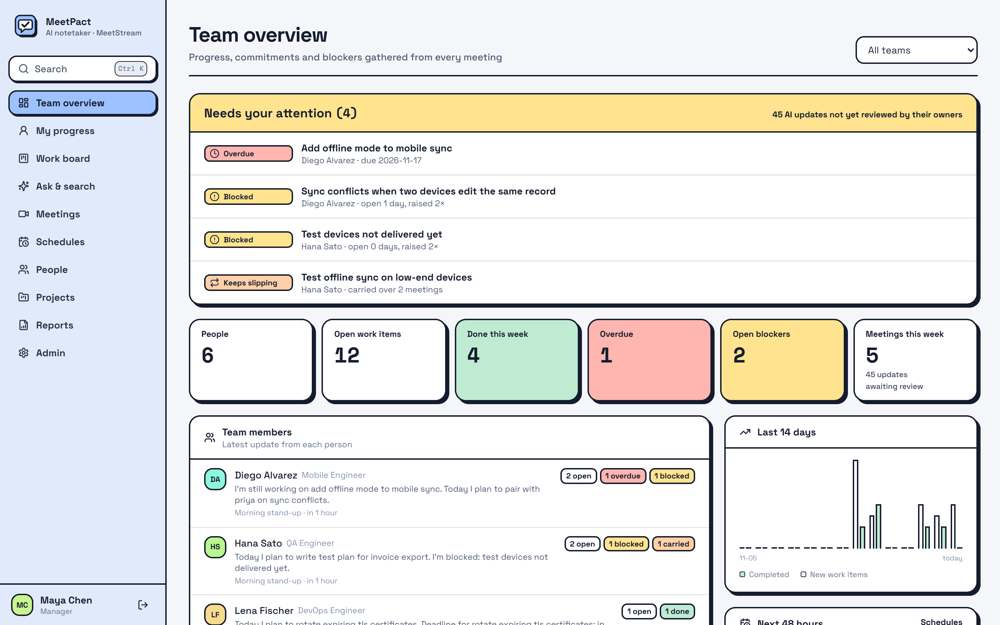
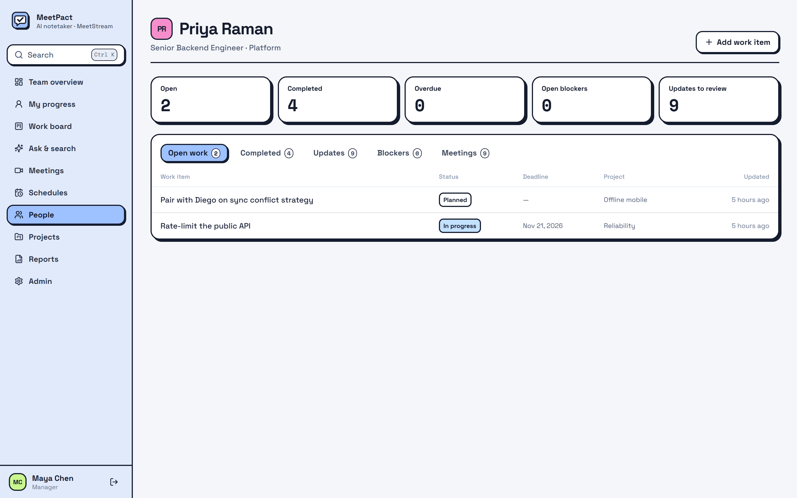
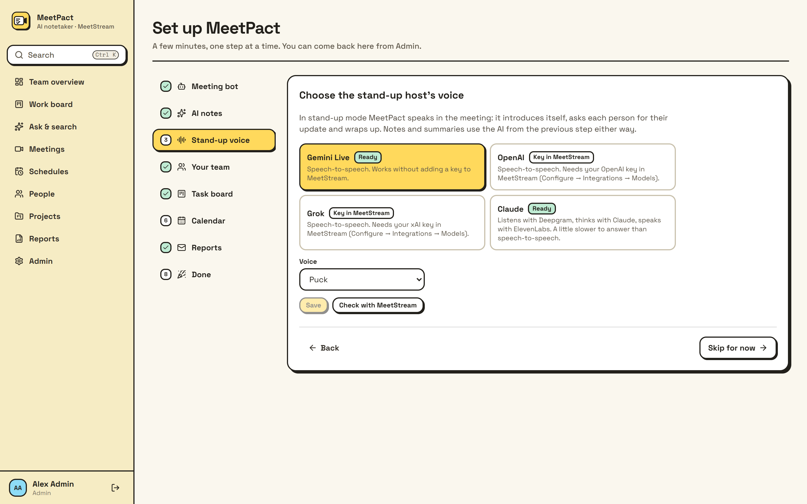
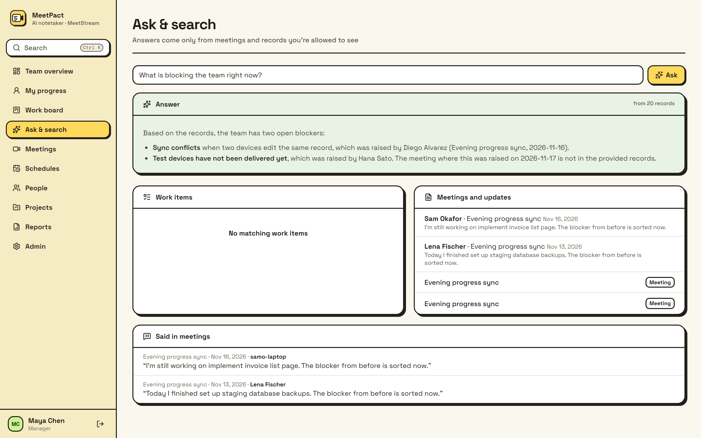

<div align="center">


# MeetPact

**A bot joins your stand-up or team meeting, writes the notes, and remembers what everyone said they'd do, so the next meeting starts where the last one ended.**

[](https://github.com/meetstream-ai/meetpact/actions)

[](https://meetstream.ai)
[](LICENSE)

[Quick start](#-quick-start) · [Demo](#-demo) · [Architecture](#%EF%B8%8F-architecture) · [Docker](#-docker) · [Configuration](#%EF%B8%8F-configuration) · [FAQ](#-faq)

</div>

<div align="center">

<br />
<sub>Team overview → meeting report → each person's update → work board → Ask</sub>
</div>

&nbsp;

Send a bot into your call via **[MeetStream](https://meetstream.ai)** (Google Meet, Zoom, Teams). When the meeting ends, MeetPact **fetches the transcript**, runs it through the AI you choose (Gemini, Claude, OpenAI or Grok) and keeps what was said as **knowledge per person**: what they finished, what they're working on, what they promised and by when, and what's blocking them. Your team keeps its tasks on MeetPact's board or its own Trello board, and an **AI stand-up host** can run the meeting out loud: it asks each person for their update, follows up on their open tasks and what they said last time, and leaves when it's done. Built for teams who want meeting intelligence on infrastructure they own.

## 🚀 Quick start

```bash
git clone https://github.com/meetstream-ai/meetpact.git
cd meetpact
docker compose up -d      # → http://localhost:8000
```

Open it, create the admin account and follow the **setup guide**: MeetStream key, the AI for notes, the stand-up voice, your team, its task board, calendar and reports. Each step has a live check.

To send a bot into a call you need a MeetStream API key: sign up at [app.meetstream.ai](https://app.meetstream.ai).

## 📥 Installation

| Where | How | Then |
|---|---|---|
| **Docker** | `docker compose up -d` | <http://localhost:8000> |
| **Your server** | Docker + a domain + HTTPS, `APP_URL=https://your-domain` | [docs/self-hosting.md](docs/self-hosting.md) |
| **Source** | Python 3.12+ and Node 22+ | [docs/development.md](docs/development.md) |

> [!TIP]
> No `.env` needed: the setup guide stores keys in MeetPact's database, and the app creates and upgrades its own schema. A variable set in `.env` always wins.

## 💡 Why MeetPact?

- **Meetings have a memory** - each person's updates, commitments and blockers carry from one meeting to the next, so nobody has to remember what was promised.
- **People own the board** - the AI writes notes and knowledge; your team decides what goes on the board. Turn on *Let meetings update the board* if you want the AI to create and move tasks too.
- **Bring your own AI** - Gemini, Claude, OpenAI or Grok for notes; Gemini Live, OpenAI, Grok or Claude as the stand-up voice.
- **Your data stays with you** - self-hosted, SQLite by default, no telemetry.

## ✨ Features

- 🎥 **Meeting capture** - the bot joins Google Meet, Zoom or Teams on demand, on a schedule, or from Google Calendar; it posts one short recording note and can be paused or removed.
- 📅 **Calendar auto-join** - connect Google Calendar in one click (or Outlook with a refresh token) and the bot books itself into every meeting with a link, minus the titles you filter out.
- 🚪 **Joins without the host** - optionally, Google Meet bots join signed in to a bot account on the invite, so they don't wait to be admitted; an admitted bot waits up to 30 minutes for a late host.
- 🧠 **Knowledge per person** - summary, decisions, action items, and each person's update: done, in progress, planned, commitments with deadlines, blockers.
- 🧑‍✈️ **AI stand-up host** - opens with *"tell me what you worked on, any updates and your status"*, goes round each person by name, asks about their open tasks, takes updates from anyone else in the call, recaps and leaves.
- 🗂️ **Work board or Trello** - each team picks MeetPact's board or its Trello board, shown inside MeetPact with who is on each card. ClickUp, Jira, Asana and monday.com sync too ([docs/integrations.md](docs/integrations.md)).
- 🚨 **Needs your attention** - the dashboard leads with overdue work, open blockers and work that keeps slipping.
- 🔍 **Ask** - "What is blocking the team?" Answers cite the meeting and only use what you're allowed to see.
- 🔐 **Roles and sharing** - admins, managers, team leads, employees; per-meeting sharing; automatic deletion of recordings.
- 📤 **Delivery** - reports by email and Slack.
- 🧭 **Setup guide** - first-run guide with live checks; no files to edit.

## 📸 Screenshots

<div align="center">






</div>

## 🎬 Demo

The walkthrough at the top goes from the team overview to a meeting report, each person's update, the work board and Ask.

**Ask** - a grounded answer with the meetings it came from:

<div align="center"></div>

## 🏗️ Architecture

```
  Browser  ──▶  React UI  ──▶  FastAPI  ──▶  Services  ──▶  MeetStream API (bots, transcripts, MIA voice agents)
  MeetStream webhooks ─▶ /api/webhooks          │           ├─ AI: Gemini · Claude · OpenAI · Grok
  Stand-up voice agent ─▶ /api/agent, /mcp ─────┘           ├─ Trello (team boards) · Slack · SMTP
                                                            └─ Database: SQLite (default) · PostgreSQL
```

**Data flow for a meeting.** Bot joins (now, scheduled or from the calendar) → one recording note in the chat → call ends → transcript fetched → speakers matched to people → the AI gets the transcript **and** each person's open tasks and blockers, and returns typed JSON → stored as each person's update, blockers and notes on the tasks that came up → report by email and Slack → dashboards, Ask and the next stand-up use it.

**The stand-up host** is a MeetStream MIA voice agent created per meeting. Its instructions carry the team, each person's last update and open tasks; with a public address it also gets tools to see who joined and to leave after its goodbye. Full detail: [docs/architecture.md](docs/architecture.md) · [docs/standup.md](docs/standup.md).

## 🗂️ Project structure

```
backend/app/    FastAPI - api/ (routes) · services/ (meetstream, processing, extraction, tracker, standup,
                voices, trello_board, delivery, calendar_sync) · models.py · migrations/ (Alembic)
backend/tests/  pytest (throwaway SQLite, no network)
frontend/src/   React - pages/ (one per route) · components/ · api.js (all HTTP calls)
docs/           documentation and screenshots
```

## 🐳 Docker

```bash
docker compose up -d       # app on http://localhost:8000, SQLite in a volume
```

- **First visit** opens the setup guide; keys and settings live in the database volume.
- **Skip the guide** by setting `MEETSTREAM_API_KEY` and an AI key in `.env`.
- The image is built in CI on every push.

> [!IMPORTANT]
> For live webhooks and the stand-up host's tools, MeetStream must reach your server: a public `APP_URL`, or on a laptop the automatic Cloudflare tunnel ([docs/self-hosting.md](docs/self-hosting.md)). Notes and reports work without it.

## ⚙️ Configuration

Set from the **setup guide** and **Admin**, saved in the database. An **environment variable that is set always wins**.

| Variable | Default | Purpose |
|---|---|---|
| `MEETSTREAM_API_KEY` | from the guide | Sends bots and the stand-up host |
| `ANALYSIS_PROVIDER` + its key | first key found | `gemini`, `anthropic`, `openai` or `xai` for notes and Ask |
| `APP_URL` | `http://localhost:8000` (Docker) | Your domain on a server; links, Google sign-in and MeetStream callbacks follow it |
| `GOOGLE_CLIENT_ID` + `GOOGLE_CLIENT_SECRET` | - | One-click Google Calendar connect |
| `NO_ONE_JOINED_TIMEOUT` | `600` | Seconds an admitted bot waits for a late host (up to 1800) |
| `GOOGLE_BOT_LOGIN_DOMAIN` | - | Google Meet bots join signed in, without being admitted |
| `DATABASE_URL` | local SQLite | `postgresql+psycopg://…` for PostgreSQL |
| `TUNNEL` | `auto` | On a laptop, start a Cloudflare tunnel when `cloudflared` is installed |

Every variable: [docs/configuration.md](docs/configuration.md).

## 🧰 Technology stack

**Backend** Python 3.15 · FastAPI · SQLAlchemy 2 · Alembic · SQLite / PostgreSQL · **AI** Gemini, Claude, OpenAI and Grok over HTTP · **Frontend** React 19 · Vite 8 · Tailwind CSS 4 · **Integration** MeetStream bots and MIA voice agents, webhooks, MCP · Trello, Slack, SMTP, Google Calendar.

## 📦 Dependencies

Listed in [`backend/requirements.txt`](backend/requirements.txt) and [`frontend/package.json`](frontend/package.json); Dependabot keeps them current.

## 🧪 Running tests

```bash
cd backend && python -m pytest      # throwaway SQLite, MeetStream and AI providers mocked, no network
cd frontend && npm test             # vitest
cd frontend && npm run build        # production build
```

## 🔁 CI/CD

**Every push / PR** ([`ci.yml`](.github/workflows/ci.yml)): backend tests, frontend tests and build, Docker image build. Dependabot opens weekly updates for Python, npm, Docker and Actions.

## 🩺 Troubleshooting

| Symptom | Cause | Fix |
|---|---|---|
| Stand-up host says goodbye but stays | MeetStream can't reach your server | Public `APP_URL`, or install `cloudflared` on a laptop |
| Voice check: *API key not configured* | MeetStream has no key for that provider | Add it at app.meetstream.ai → Configure → Integrations |
| Report not analysed | AI key or model rejected | Setup guide → AI notes → *Save and check*, then **Re-analyse** |
| Names misheard in the notes | Speech-to-text | Add aliases under Admin → Employees and keywords on projects |
| Bot waits in the lobby | Google Meet asks someone to admit a guest bot | Admit it, use a [signed-in bot](docs/configuration.md#signed-in-google-meet-bot), or set the meeting's access to *Open* |

More: [docs/troubleshooting.md](docs/troubleshooting.md).

## ❓ FAQ

**Does the AI change our board?** Not by default. Meetings add knowledge; people manage the board. *Admin → Let meetings update the board* turns automatic tasks on.

**Which AI models?** Gemini, Claude, OpenAI or Grok for notes; the stand-up voice is Gemini Live, OpenAI, Grok or Claude.

**What if the host doesn't join?** A guest bot has to be admitted. A [signed-in Google Meet bot](docs/configuration.md#signed-in-google-meet-bot) on the invite joins by itself, and `NO_ONE_JOINED_TIMEOUT` keeps an admitted bot waiting up to 30 minutes.

**Can the bot see who's in the call?** It gets live join and leave events when MeetStream can reach your server; it also asks "anyone else with an update?"

**Is it free?** MIT, no accounts, no telemetry. You pay only MeetStream and the AI provider you choose.

## 📚 Documentation

[Self-hosting](docs/self-hosting.md) · [Configuration](docs/configuration.md) · [AI stand-up host](docs/standup.md) · [Integrations](docs/integrations.md) · [Architecture](docs/architecture.md) · [Privacy](docs/privacy.md) · [Troubleshooting](docs/troubleshooting.md) · [For developers](docs/development.md) · [Agent guide](AGENTS.md) · [Security policy](SECURITY.md)

## 🤝 Contributing

Issues and pull requests are welcome - start with [CONTRIBUTING.md](CONTRIBUTING.md). Run the tests before opening a pull request.

## 📄 License

[MIT](LICENSE). Created by [Thalha Ahamed](https://github.com/ThalhaAhamed) and maintained by [MeetStream](https://meetstream.ai). Built on [MeetStream](https://meetstream.ai), FastAPI, SQLAlchemy, React, Vite and Tailwind.
